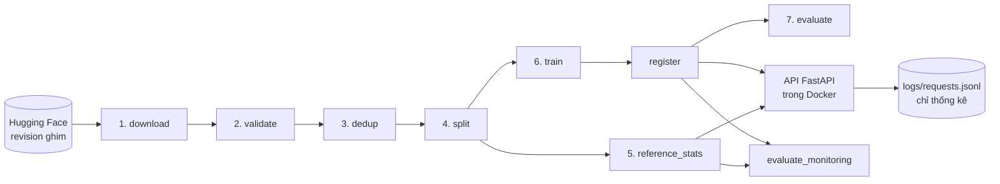
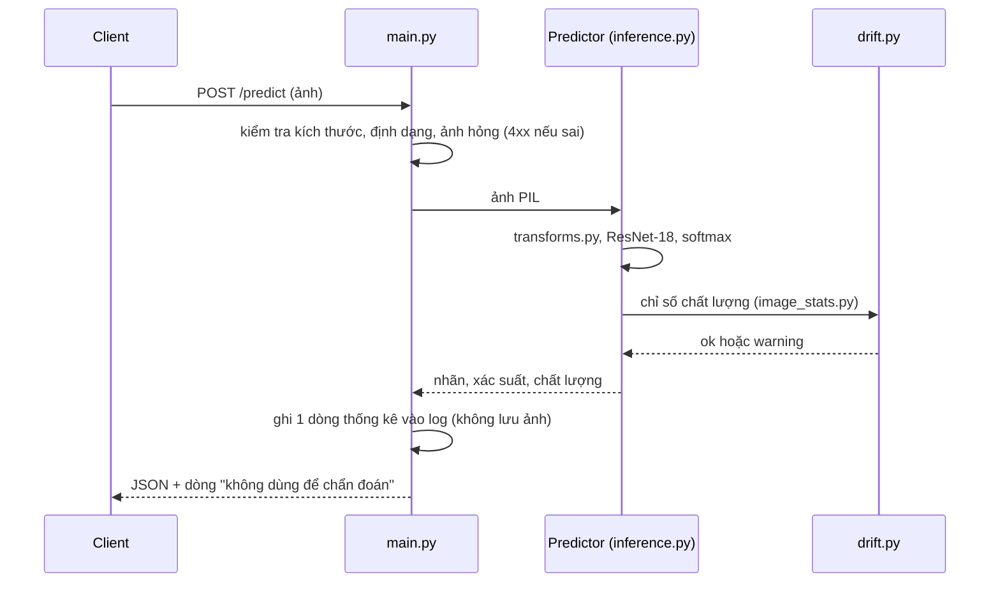

# Kiến trúc hệ thống

Tài liệu này mô tả luồng dữ liệu từ lúc tải ảnh tới lúc API trả kết quả. Mã quyết định (D1, D2...) trỏ tới `docs/decisions.md`.

## Tổng quan



- Bước 1 đến 7 chạy bằng một lệnh: `scripts/run_pipeline.py`.
- `evaluate_monitoring` và `benchmark_latency` chạy riêng, sau khi đã có model.

## Các bước của pipeline

Mỗi bước là một module Python, chạy bằng `uv run python -m <module>`. Mỗi bước đọc file đầu vào và ghi file đầu ra, nên chạy lại từng bước độc lập được.

| Bước | Module | Đầu vào | Đầu ra |
| :-- | :-- | :-- | :-- |
| 1. download | `cxr.data.download` | Hugging Face | `data/raw/images/`, `data/interim/manifest.csv`, `reports/data_quality/counts.json` |
| 2. validate | `cxr.data.validate` | manifest | `data/interim/validation.csv`, báo cáo kiểm tra ảnh |
| 3. dedup | `cxr.data.dedup` | validation | `data/interim/dedup.csv` (có `group_id`, `patient_id`), danh sách cặp trùng |
| 4. split | `cxr.data.split` | dedup, validation (cờ loại ảnh), cặp trùng | `data/processed/splits.csv`, báo cáo chia tập |
| 5. reference_stats | `cxr.data.reference_stats` | ảnh train | `data/reference/stats.json` (phân vị các chỉ số chất lượng) |
| 6. train | `cxr.models.train` | splits | `runs/<run_name>/`: `best.pt`, `history.json`, `config.json`, ngưỡng chọn trên val |
| register | `cxr.models.registry` | một run | `models/<version>/`: `model.pt`, `metadata.json` |
| 7. evaluate | `cxr.evaluation.evaluate` | model, test | `reports/evaluation/<version>/test_metrics.json` (kèm khoảng tin cậy bootstrap) |

Cấu hình nằm trong `configs/`, không viết cứng trong code:

| File | Dùng cho |
| :-- | :-- |
| `data.yaml` | Nguồn dữ liệu, ngưỡng kiểm tra, pHash, chia tập, tiền xử lý ảnh |
| `train.yaml`, `train_baseline.yaml` | Mô hình chính và baseline |
| `eval.yaml` | Cách chọn ngưỡng, bootstrap, ngưỡng chấp nhận |
| `monitor.yaml` | Chỉ số giám sát, mức suy giảm nhân tạo |
| `api.yaml` | Đường dẫn model, giới hạn file tải lên, đo độ trễ |

## Nguyên tắc thiết kế

- **Một nguồn tiền xử lý.** `src/cxr/data/transforms.py` dùng chung cho train, đánh giá, API và giám sát. Test `tests/integration/test_api_matches_offline.py` kiểm tra xác suất từ API lệch < 1e-5 so với đánh giá offline. Lần đo thử trên container ngày 29/10/2026, đủ 624 ảnh test: lệch tối đa 1,19e-7 (ghi ở D12, chưa lưu thành file báo cáo).
- **Thống kê chỉ tính trên train.** Tham chiếu giám sát (`data/reference/stats.json`) chỉ tính trên train. Chuẩn hóa ảnh dùng mean/std cố định của ImageNet (`configs/data.yaml`), không tính từ dữ liệu.
- **Test chỉ đo một lần.** `evaluate` và `evaluate_monitoring` từ chối ghi đè kết quả test đã có. Ngưỡng quyết định chọn trên val, áp nguyên lên test.
- **Ghi nguồn gốc.** Mỗi run và mỗi model ghi commit git, revision dữ liệu và mã hash của `splits.csv` (`src/cxr/utils/provenance.py`).
- **Không ghi đè.** Model có phiên bản. `register` và `run_pipeline.py` từ chối ghi đè phiên bản đã có.

## API suy luận



- Model nạp một lần khi khởi động, chạy trên CPU.
- Cảnh báo chất lượng không chặn dự đoán, chỉ báo cho người dùng biết.
- Đóng gói bằng `Dockerfile`: image `python:3.11-slim`, torch bản CPU, chạy bằng user thường.

## Giám sát đầu vào

- `image_stats.py` đo 5 chỉ số trên mỗi ảnh: độ sáng, độ tương phản, độ nét (phương sai Laplacian), nhiễu, độ "khối" của nén JPEG.
- `drift.py` so mỗi chỉ số với khoảng phân vị của train. Mỗi chỉ số chỉ kiểm theo hướng mà suy giảm đẩy nó đi (D9).
- `degrade.py` tạo ảnh mờ, nhiễu, tối, nén JPEG với 4 mức biết trước (D10).
- `evaluate_monitoring.py` đo tỉ lệ cảnh báo nhầm trên ảnh sạch, tỉ lệ phát hiện theo từng mức, và AUC của mô hình trên ảnh suy giảm.

## Mã nguồn

```
src/cxr/
├── data/         bước 1 đến 5, dataset, transforms
├── models/       build, train, registry
├── evaluation/   metrics, bootstrap, evaluate, error_analysis, multi_seed
├── monitoring/   image_stats, drift, degrade, store, evaluate_monitoring
├── api/          main, inference, schemas, benchmark_latency
└── utils/        config, seed, provenance
scripts/run_pipeline.py
tests/unit/, tests/integration/
```
